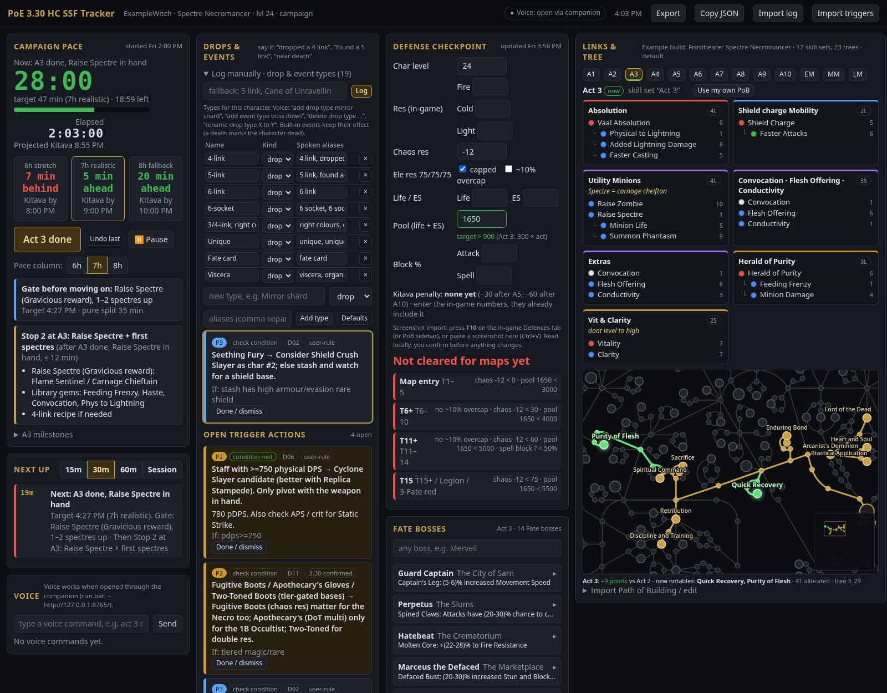

# PoE-Roadmap

A campaign and mapping roadmap tracker for **Path of Exile 1**, built with **Hardcore SSF** in mind (it works fine for softcore and trade too). Keep it open on a second monitor and it tells you, at a glance, where you are against your pace, what to link at this stage, whether your defenses are ready for the next tier, and what's worth farming next.

It's a single web page (`poe_tracker.html`) plus an optional **Windows voice companion** (`voice/`), so you can log things by voice without leaving the game.



*Screenshot: the example build (Frostbearer Spectre Necromancer) with a made-up character.*

## What it does
- **Path of Building import.** Paste a PoB export code or a pobb.in / poe.ninja link, or drop the `.xml` file. Any PoB works: skill sets and trees named by act ("Act 3", "Act 4-10"), by level ("Lvl 30"), by name ("Early maps", "Endgame"), or just a single tree. You get link cards for each stage and a passive tree closeup with the new nodes for that stage in green. See [Making your PoB compatible](docs/POB_GUIDE.md).
- **Act timer and pace.** A league timer with splits per act and "ahead / behind" for each pace. Pick a preset (league start ≈6–8 h, alt character ≈3.5–4.5 h, speedrun ≈2–3 h) or set your own target. Pause when you're away. "Restart timer" starts a new run and keeps the old one in history.
- **Next Up.** What to do in the next 15 / 30 / 60 minutes or this session, including gates you haven't met and lab trials you missed.
- **Defense Checkpoint.** Res, chaos res, life, ES, pool, block, Kitava penalties, and your choice of extra stats (Mind over Matter, evasion, evade, suppression, armour, phys reduction, endurance charges, phys taken as). Each map tier (Map entry, T6+, T11+, T15+, Pinnacle, Uber) has its own thresholds, and the panel shows which tiers you're cleared for.
- **EHP and max hit (approximate).** A PoB-style line under your defenses: `Max hit: Phys · Fire · Cold · Light · Chaos · EHP ~N`. It uses PoB's armour formula, resistances, endurance charges, phys taken as, MoM, block, evade and suppression. It's a guide, not a PoB replacement: flasks, guard skills and buffs are not included. Hover the ⓘ for the formulas. You can turn it off in Configure.
- **Power Chase.** An endgame checklist you turn on once you're mapping. Every item is colour-coded by the content it comes from (Delve, Legion, Abyss, Atlas bosses…), and item names link to their poewiki page.
- **Fate panel.** Fate boss (Wickerman / viscera) rewards for every campaign boss, the bosses in your current area, and which ones you've already killed.
- **Lab trials.** The six normal-lab trials. Mark them done or missed; missed ones show up in Next Up before you do the lab.
- **Drops and events.** Your own drop and event types per character ("6 link", "Fate card", "boss down"…) with actions for the important ones.
- **Configure page.** Choose which defense stats to show, edit the per-tier checks, drop and event triggers, rules, pace, text size, and panels.
- **Layout.** Drag and drop the panels into the order you like, and set the text size.
- **Backups.** Download one `.json` with everything, and restore it on another PC.

## Voice companion (optional, Windows)
- **Push-to-talk.** Hold the hotkey (F9 by default, or any key you like), say what happened, let go. You hear a beep and a short spoken reply, and the tracker updates. The hotkey is listen-only; the game still gets the key.
- **Local speech to text.** Speech is transcribed on your own PC with [faster-whisper](https://github.com/SYSTRAN/faster-whisper). Nothing is sent anywhere.
- **Spoken replies.** Short readbacks through Windows text-to-speech, so you never have to look away from the game.
- **Screenshot reading (F10).** Open your character panel (Defences tab or the PoB sidebar) and press F10. The numbers are read locally with OCR and shown for you to check. Nothing changes until you say "yes" or "confirmed".
- **Wiki links.** "Link for Headhunter" or "wiki Forged Frostbearer" opens the poewiki page.
- **Research (optional).** "Research Desecrate" reads the poewiki page. If you set your own `OPENAI_API_KEY`, it also gives a short answer based on that page. No key, no OpenAI calls.

A few things you can say: "act 3 done", "fire 75 cold 75 lightning 60", "chaos minus 20", "what are my links?", "Hillock down", "missed the lab trial in the prison", "what's the reward for Merveil?". The full list is in the [cheat sheet](docs/GETTING_STARTED.md#voice-command-cheat-sheet). Anything it doesn't understand is saved as a note with your exact words.

## What it does NOT do
- **No packets.** It never reads, sends or changes game network traffic.
- **No input automation.** It never sends keys or mouse clicks, never blocks or remaps keys, and has no macros. The hotkeys are listen-only, the same kind Discord and OBS use for push-to-talk.
- **No memory reading, no game files.** It doesn't read the game's memory and doesn't read or modify game files.
- **No trade or market features.** No price checking, no trade searches, no whispers.
- **It doesn't play the game for you.** Everything it knows, you told it: by voice, by typing, from your own PoB, or from a screenshot of your own screen that you triggered.

It's designed to stay well inside GGG's Terms of Service: listen-only hotkeys and screenshots of your own screen, nothing more. As always with third-party tools, use your own judgement.

**Your data stays with you.** Tracker data lives in your browser's localStorage. Speech and screenshots are processed on your PC. The only network calls are the ones you ask for: wiki lookups (poewiki.net, poedb.tw), importing a pobb.in / poe.ninja link, the Fate data refresh, and, only if you set a key, OpenAI for research.

This is a fan-made tool and isn't affiliated with or endorsed by Grinding Gear Games.

## Fun features
- **"Go to bed" alert.** Two near-deaths within 30 minutes and it tells you to end the session before Hardcore ends it for you. The rule is editable in Configure.
- **"Dropped a 6 link!"** Say it and it's logged, with a celebration or an action for the drops you care about.
- **Boss-kill callouts.** "Hillock down", "Fairgraves is dead", "Merveil dead": logged as kills, and the Fate panel ticks them off.
- **Fate boss lookups by voice.** "What fate does the Great White Beast give?" It handles loose names, so "Caliph Headstaver" still finds Calaf.
- **Where am I?** "We're in the Submerged Passage" sets your area and shows that area's Fate boss and lab trial (Acts 1–3 for now).
- **Power Chase farm steps.** "What am I watching for in Abyss?" tells you which of your open upgrades come from that content.
- **Kitava reminders.** The res penalty after Acts 5 and 10 is handled, and stale res numbers get flagged.

## Quick start (Windows)
1. Download the repo (Code → Download ZIP) or `git clone https://github.com/dsledge1/PoE-Roadmap.git`.
2. Double-click `voice\setup.bat` once. It takes 5–10 minutes and downloads the speech model.
3. Double-click `voice\run.bat`. The tracker opens at http://127.0.0.1:8765/.
4. Click **Import PoB build** at the top and paste your PoB code or link, or choose your `.xml`.

No voice? Open `poe_tracker.html` straight from disk and type or click instead. PoB import, F10 and research need the companion running.

The full walkthrough, with mic setup and troubleshooting, is in **[Getting Started](docs/GETTING_STARTED.md)**.

## Changing the hotkey
The companion writes `voice\config.json` the first time it runs (every setting and its default is in [`voice/config.example.json`](voice/config.example.json)). Edit `"hotkey"` and restart `run.bat`:

```json
"hotkey": "`",
"ocr_hotkey": "f10"
```

Any key name works: `"f9"`, `"f8"`, `` "`" ``, `"scroll_lock"`, `"pause"`, `"insert"`, or a mouse button (`"mouse:x1"`, `"mouse:x2"`, `"mouse:middle"`). Pick a key PoE has nothing bound to. Set `"ocr_hotkey": ""` to turn screenshot reading off. `config.json` is ignored by git, so your settings stay local.

## Requirements
- **Windows 10 or 11** for the voice companion. The tracker page alone runs in any modern browser (Chrome, Edge, Firefox).
- **Python 3.10+** for the voice companion. `setup.bat` installs everything else into a private `.venv`.
- **A microphone.** A headset mic is fine.
- **NVIDIA GPU (optional).** Whisper uses CUDA if you have it; on CPU it's about a second slower per command.
- **Node.js** only to rebuild `poe_tracker.html` from `src/` or run the browser tests. Players don't need it.

## Running the tests
```bash
# Python (parser, OCR, PoB import, research, voice phrases)
cd voice
for t in test_parser test_parser_holdout test_parser_v3 test_parser_v4 test_rare_names test_v3_data \
         test_research test_ocr test_cheatsheet test_v5 test_v51 test_v52 test_v53; do python $t.py; done

# Browser (needs Node, playwright-core and Chrome/Chromium; PY = Python with voice/requirements.txt)
npm install
node build.js
npm test            # tracker page + import UI
npm run test:e2e    # end-to-end through the voice companion (no mic needed)
```
`test/env.js` lists the environment variables (`CHROME_PATH`, `PY`, `POE_TEST_TMP`). Tests that need a real screenshot or your own PoB skip themselves unless you point them at one (`POE_OCR_REAL_SAMPLE`, `POE_OCR_LV4`, `POE_OCR_LV97`, `POE_PRIVATE_POB`). More in [CONTRIBUTING.md](CONTRIBUTING.md).

## Repository layout
| Path | What it is |
|---|---|
| `poe_tracker.html` | The built tracker page (one file, no dependencies). |
| `src/` | Tracker source. `node build.js` turns it into `poe_tracker.html`. |
| `data/` | Default triggers and the stage plan the build embeds. |
| `voice/` | Windows voice companion: speech, OCR, research, PoB import, `setup.bat`, `run.bat`, Python tests. |
| `docs/` | [Getting Started](docs/GETTING_STARTED.md), [PoB guide](docs/POB_GUIDE.md), an [example PoB](docs/examples/example_pob.xml), and per-version notes in `docs/history/`. |
| `test/` | Browser tests (Playwright) and public example PoBs in `test/fixtures/`. |
| `tools/` | Helper for dumping Path of Building data. |

## Changelog
See [CHANGELOG.md](CHANGELOG.md). The latest release is **5.3**, with lab trials, new runs, boss kills, Fate questions and EHP ([details](docs/history/v5.3.md)).

## Contributing
Issues and pull requests are welcome. Fork it and make it yours. See [CONTRIBUTING.md](CONTRIBUTING.md).

## Credits
- [poewiki.net](https://www.poewiki.net/) (the community Path of Exile Wiki): wiki links, research answers and Fate data.
- [poedb.tw](https://poedb.tw/): mod values and Fate boss data.
- [Path of Building Community](https://github.com/PathOfBuildingCommunity/PathOfBuilding): build format, passive tree and gem data, and the armour formula behind the EHP line.
- [faster-whisper](https://github.com/SYSTRAN/faster-whisper) for local speech recognition, and [RapidOCR](https://github.com/RapidAI/RapidOCR) as the fallback OCR engine.

Path of Exile is a trademark of Grinding Gear Games.

## License
[MIT](LICENSE)
